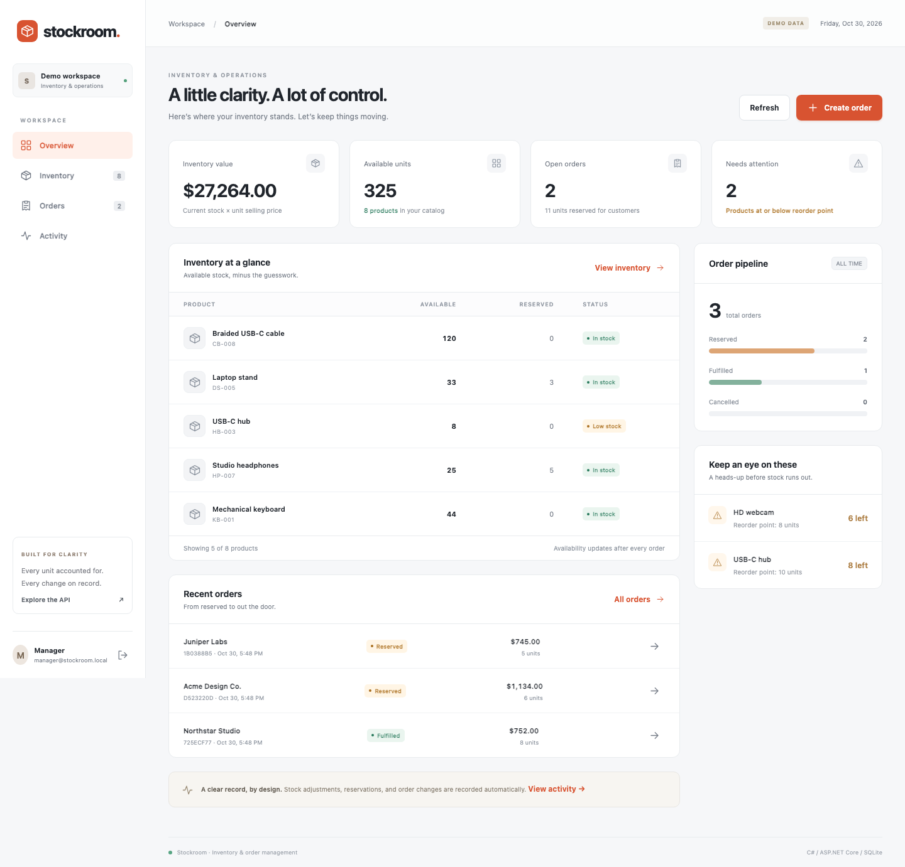
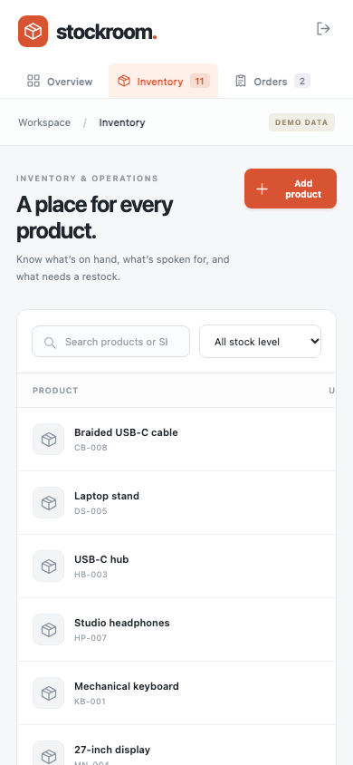

# Stockroom

**Inventory you can trust. Orders you can trace.**

[](https://github.com/mRaphinityz/stockroom/actions/workflows/ci.yml)


A full-stack C# application for a small team's inventory and order operations. Managers maintain stock and reserve, fulfill, or cancel orders. Viewers can inspect the same workspace without changing it. Every successful stock change creates an audit event in the same transaction.



**[Design & tradeoffs](docs/ARCHITECTURE.md) · [API examples](docs/API.md) · [Interview walkthrough](docs/INTERVIEW_GUIDE.md)**

## The problem

Two customers order the last keyboard at the same time. A browser retries an order after losing its response. A stock count changes while a manager is editing it. These ordinary events can corrupt a basic inventory app.

Stockroom makes those cases explicit:

| Behavior | Implementation | Evidence |
| --- | --- | --- |
| Prevent overselling | Conditional stock update inside a SQLite write transaction | Six simultaneous orders compete for one unit; exactly one succeeds |
| Avoid duplicate reservations | Unique idempotency key plus a hash of the normalized request | Concurrent retries return one order and reserve once |
| Reserve all items or none | Product updates, order lines, and audit events share one transaction | An unavailable second item rolls back the first item and its event |
| Protect existing reservations | Database constraint: `0 <= Reserved <= OnHand` | Adjustments cannot remove reserved units |
| Detect stale stock edits | Client sends the product version it last read | A stale adjustment receives HTTP 409 |
| Preserve order history | Unit prices and names are copied onto order lines | Totals use the price snapshot and integer cents |
| Enforce read-only access | ASP.NET Core Identity cookies and server-side role policies | Viewer writes receive HTTP 403; anonymous reads receive 401 |

These scenarios are covered by [automated tests](tests/Stockroom.Tests/InventoryApiTests.cs), using an actual temporary SQLite database and the application's real HTTP pipeline.

## Run it

Install the **[.NET 10 SDK](https://dotnet.microsoft.com/download/dotnet/10.0)**. No separate database server, Node.js installation, or API key is needed to run the app.

```sh
git clone https://github.com/mRaphinityz/stockroom.git
cd stockroom
dotnet restore --locked-mode
dotnet run --project src/Stockroom.Web
```

Open **[localhost:5080](http://localhost:5080)** and choose **Try as manager** or **Try as viewer**. The launch profile enables local Development mode, applies the checked-in migration, and seeds sample products and orders. Changes persist in `src/Stockroom.Web/App_Data/`, which Git ignores.

| Local demo account | Password | Access |
| --- | --- | --- |
| `manager@stockroom.local` | `Demo.Manager42!` | Read and write |
| `viewer@stockroom.local` | `Demo.Viewer42!` | Read only |

Demo accounts are local fixtures. Enabling them outside Development causes startup to fail.

### Or use Docker

```sh
docker compose up --build
```

Open [localhost:8080](http://localhost:8080). Compose binds to the local computer, enables the local demo, and persists the database and cookie-protection keys in named volumes.

## A three-minute demo

1. Sign in as manager. Review available units, reserved units, and low-stock alerts.
2. Add a product with five units. Create an order for two. Available becomes three; on-hand stays five.
3. Open the order and **Confirm fulfillment**. On-hand becomes three and reserved becomes zero.
4. Create another order and cancel it. Its reserved units become available again.
5. Open **Activity** to see the actor, reason, and stock deltas. Sign in as viewer to inspect read-only access.

Inventory search, stock filters, status filters, and pagination are included. The responsive interface works on phones; wide tables scroll within their cards.

<details>
<summary>Phone screenshot</summary>



</details>

## Stack

- **Backend:** C#, .NET 10, ASP.NET Core Minimal APIs, ASP.NET Core Identity.
- **Persistence:** Entity Framework Core, checked-in migrations, SQLite with write-ahead logging, constraints, indexes, and transactions.
- **Frontend:** semantic HTML, responsive CSS, and native JavaScript served by ASP.NET Core. Same-origin cookies avoid a separate token-storage or CORS setup.
- **Verification:** xUnit, `WebApplicationFactory`, real SQLite integration tests, and Playwright browser checks.
- **Delivery:** locked dependencies, warnings as errors, formatting checks, GitHub Actions, and a non-root Docker image.

The application is intentionally one deployable service. The [architecture notes](docs/ARCHITECTURE.md) explain why and what would change with more traffic.

## Verify it

```sh
dotnet test
dotnet format --verify-no-changes --no-restore
```

The initial suite contains **30 passing test cases**, including concurrent requests, rollback, idempotency, authorization, CSRF protection, and order transitions.

For browser checks, install Node.js 22 or newer and keep the app running on port 5080 in another terminal:

```sh
npm ci --prefix tests/Stockroom.Browser
cd tests/Stockroom.Browser
npx playwright install chromium
npm test
```

Browser checks create sample records in the running Development workspace. They verify product creation, search, stock adjustment, reservation, cancellation, activity, the phone layout, and viewer controls. `UPDATE_SCREENSHOTS=1 npm test` refreshes the documentation screenshots. CI runs both suites and builds and starts the container.

## Repository map

```text
src/Stockroom.Web/
  Domain/       Entities, request/response contracts, order state rules
  Services/     Inventory transactions and business error handling
  Data/         EF Core mapping, migrations, and local seed data
  Endpoints/    HTTP routes and role policies
  wwwroot/      Dashboard, styles, and frontend interactions
tests/
  Stockroom.Tests/     Domain and HTTP integration tests
  Stockroom.Browser/   End-to-end browser checks
docs/           Architecture, API examples, interview guide, screenshots
```

## Scope and next steps

This is a **single-workspace portfolio application**, with no claim of production traffic or measured performance gains. Inventory value is on-hand quantity × selling price; it is not an accounting valuation. Fulfilled order value is not payment collection. Orders use USD and do not include tax, shipping, returns, or payments.

Before a public deployment, configure HTTPS and the hosting proxy, persist data-protection keys, set `Demo__Enabled=false`, and create an initial manager using `Bootstrap__Email` and `Bootstrap__Password` through the host's secret store. Remove the bootstrap password after account creation. Account invitations, password recovery, database backups, and production monitoring remain follow-up work. See [deployment considerations](docs/ARCHITECTURE.md#deployment-considerations).

Useful next contributions:

- [ ] Add a returns workflow with partial-return limits and audit tests.
- [ ] Add CSV import with row-level validation and a preview before committing.
- [ ] Move dashboard aggregation into SQL and add a searchable product picker for large catalogs.
- [ ] Add account invitations and password recovery.
- [ ] Deploy with HTTPS and capture a short narrated walkthrough.

See the [interview guide](docs/INTERVIEW_GUIDE.md) for a learning path and a resume bullet to adapt after you can explain and extend the project.

## License

[MIT](LICENSE)
