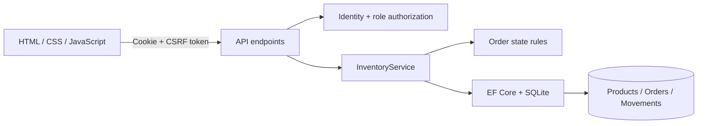

# Architecture and tradeoffs

## One application, clear boundaries

Stockroom is a single ASP.NET Core application serving a JSON API and a same-origin browser interface. The code is separated by responsibility rather than split across several services or class-library projects.

The API owns validation and authorization. Hiding manager controls in the browser improves usability; server-side policies enforce the boundary. The service owns multi-entity transactions. The domain owns permitted order transitions. EF Core owns persistence and database constraints.

## Inventory invariants

Each product stores physical `OnHand` units and `Reserved` units. `Available = OnHand - Reserved` is derived rather than persisted.

| Operation, for quantity Q | On hand | Reserved | Available |
| --- | --- | --- | --- |
| Reserve order | unchanged | +Q | -Q |
| Fulfill reserved order | -Q | -Q | unchanged |
| Cancel reserved order | unchanged | -Q | +Q |
| Adjust physical stock by Q | +Q | unchanged | +Q |

The database constrains `0 <= Reserved <= OnHand <= 1,000,000`. Adjustments cannot consume reserved units. The application rejects zero adjustments and requires a reason.

An order starts as `Reserved` and can become `Fulfilled` or `Cancelled`. Both are terminal states. Repeating a terminal action returns 409 without changing stock. Returns would be a separate operation rather than rewriting a fulfilled order.

## Reservation transaction and concurrency

1. Validate customer, quantities, duplicate lines, and the idempotency key.
2. Normalize and sort the request, then hash it with SHA-256.
3. Open a database write transaction. Microsoft.Data.Sqlite's default non-deferred transaction obtains the SQLite writer lock at the start.
4. Check whether the idempotency key already exists. Return its order when the request hash matches; reject a different request with 409.
5. For each product, issue a conditional update: increase `Reserved` only where `OnHand - Reserved >= requested quantity`. Check the affected-row count.
6. Insert the order, its price snapshots, and stock-movement events. Commit once.

A failure at any point disposes the uncommitted transaction. Even if the first product was updated, a later failure rolls it back. The unique idempotency-key index provides an additional persistence constraint.

SQLite serializes writers. Write-ahead logging helps readers coexist with a writer, but it does not create concurrent writers. The 15-second connection timeout lets competing short transactions wait for the writer lock. Sustained contention may still fail; there is no claim of unlimited throughput or automatic retry of every database error.

Reference: [Microsoft.Data.Sqlite transaction behavior](https://learn.microsoft.com/dotnet/standard/data/sqlite/transactions).

The tests use real file-backed SQLite databases, separate request scopes, and concurrent HTTP requests. An in-memory collection or EF in-memory provider would not verify these relational behaviors.

## Idempotency semantics

`POST /api/orders` requires `Idempotency-Key` (8–100 letters, digits, underscores, or hyphens). New requests receive 201. The same key and normalized payload receive 200, the original order ID, and `Idempotent-Replayed: true`. Reusing a key for a different payload receives 409.

The normalized payload includes the trimmed, case-sensitive customer name and product IDs/quantities sorted by product ID. Product prices are deliberately excluded: replaying an order should return its original price snapshot. A replay after fulfillment returns the same order in its current state.

Keys belong to this one shared workspace and remain stored with the order. The browser keeps a pending key and payload in session storage so a transport failure can be retried with the same key. It removes the entry after success or sign-out. This does not promise exactly-once execution across independent clients that choose different keys.

## Optimistic edits

Every inventory operation increments the product `Version`. A manual adjustment includes `ExpectedVersion`; if it no longer matches, the API returns 409 and the manager must refresh. The version condition and reserved-stock condition are part of the update predicate.

`Version` is also mapped as an EF concurrency token. Inventory updates use `ExecuteUpdateAsync`, which bypasses automatic tracked-entity concurrency checks, so the adjustment explicitly includes the version predicate. Reservation uses the stock predicate rather than requiring a client version.

## Money and history

Prices use integer USD cents stored as 64-bit integers. Order lines snapshot product name, SKU, and unit selling price. A later catalog change must not rewrite historical totals. Current request limits bound quantity, price, and line count. The dashboard's inventory value uses selling prices and should not be interpreted as inventory cost or recognized revenue.

Stock movements are inserted in the inventory transaction. There is no public API to edit or delete them. This is an application audit trail, not a tamper-proof ledger: a database administrator can modify the database.

## Authentication and browser security

ASP.NET Core Identity manages password hashing, lockout, roles, and cookie authentication. Manager endpoints require the Manager role; viewer access does not inherit write access. Cookie-authenticated writes, including login and logout, require an antiforgery cookie and request token. The browser fetches a fresh token after login because the token is bound to the authenticated principal.

Cookies are HttpOnly and SameSite Strict; production requires secure cookies. Login uses an in-process rate limiter partitioned by connection IP and Identity locks out an account after five failed attempts. CSP limits scripts and styles to this origin, and dynamic strings are escaped before rendering. There are no externally hosted frontend assets.

## Deliberate simplifications

- **SQLite:** makes local review easy and exercises real constraints and transactions. PostgreSQL or SQL Server is the next step for many simultaneous writers. A provider migration requires rechecking isolation, retries, conditional updates, and migrations.
- **Native JavaScript:** the four-screen app does not require a bundler or a frontend framework. A larger UI could justify TypeScript, components, and a data-fetching library.
- **No repository wrapper:** EF Core already provides change tracking, queries, and transactions; the service uses it directly.
- **No message broker:** all required changes fit in one database transaction. Sending notifications later would justify a transactional outbox.
- **Small-workspace reads:** the dashboard currently aggregates materialized products and orders; the browser loads the catalog in pages and filters it locally. A larger dataset needs SQL aggregation, server-side UI search, and a remote product picker.
- **No public registration:** this is one team's shared inventory, with local demo users or one bootstrap manager. Organization isolation and account management are follow-up features.

## Deployment considerations

The provided Compose setup is a local demo bound to `127.0.0.1`, not a public hosting configuration. The container runs as the .NET non-root app user. Database and data-protection directories are writable and can be persisted through volumes.

For a hosted environment:

1. Use Production mode and disable demo accounts. Provision the first manager with `Bootstrap__Email` and `Bootstrap__Password` in the host's secret store, then remove the bootstrap password. Startup creates missing accounts but does not rotate existing passwords.
2. Terminate TLS correctly. If using a reverse proxy, configure forwarded headers and explicitly trusted proxy addresses before enabling the public route. That configuration is host-specific and is not provided here.
3. Set `DataProtection__KeyPath` to a persistent restricted directory. Treat its contents as secrets. Avoid cookie invalidation during container replacement.
4. Persist the database, test backup and recovery, and keep migrations under release control. Startup applies migrations for this single-instance sample; use a separate migration step for a coordinated multi-instance deployment.
5. Add account recovery, invitations, structured operational monitoring, and a shared rate limiter if running multiple instances. Review the single-workspace access model before inviting unrelated users.

`GET /health` checks that the process serves requests. `GET /health/ready` verifies database connectivity; it does not prove every schema object or external dependency is healthy.
